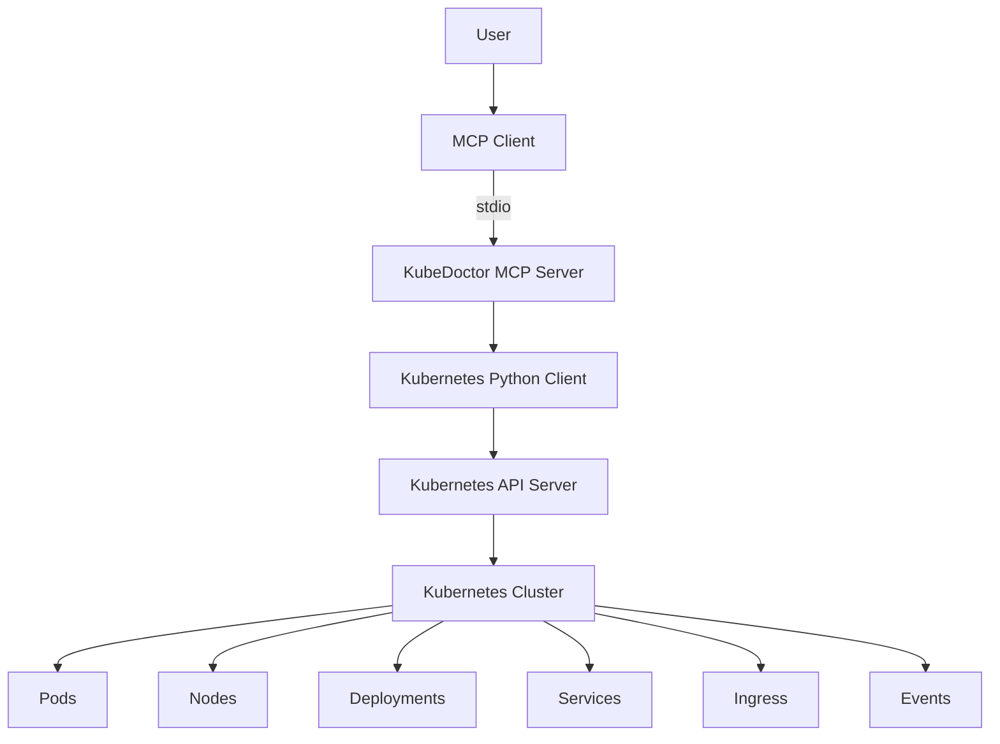
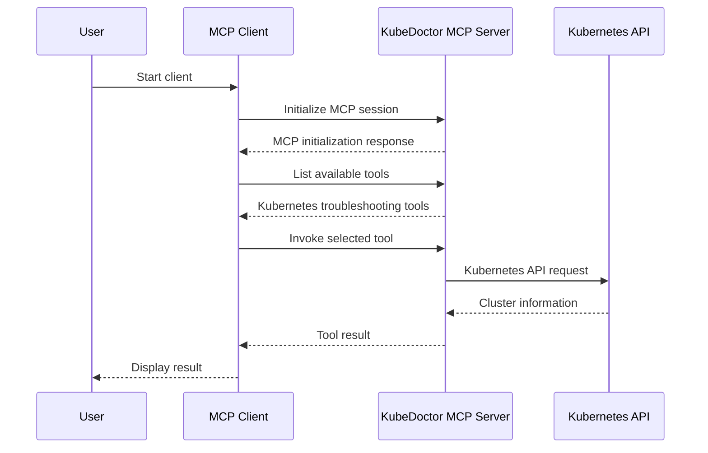
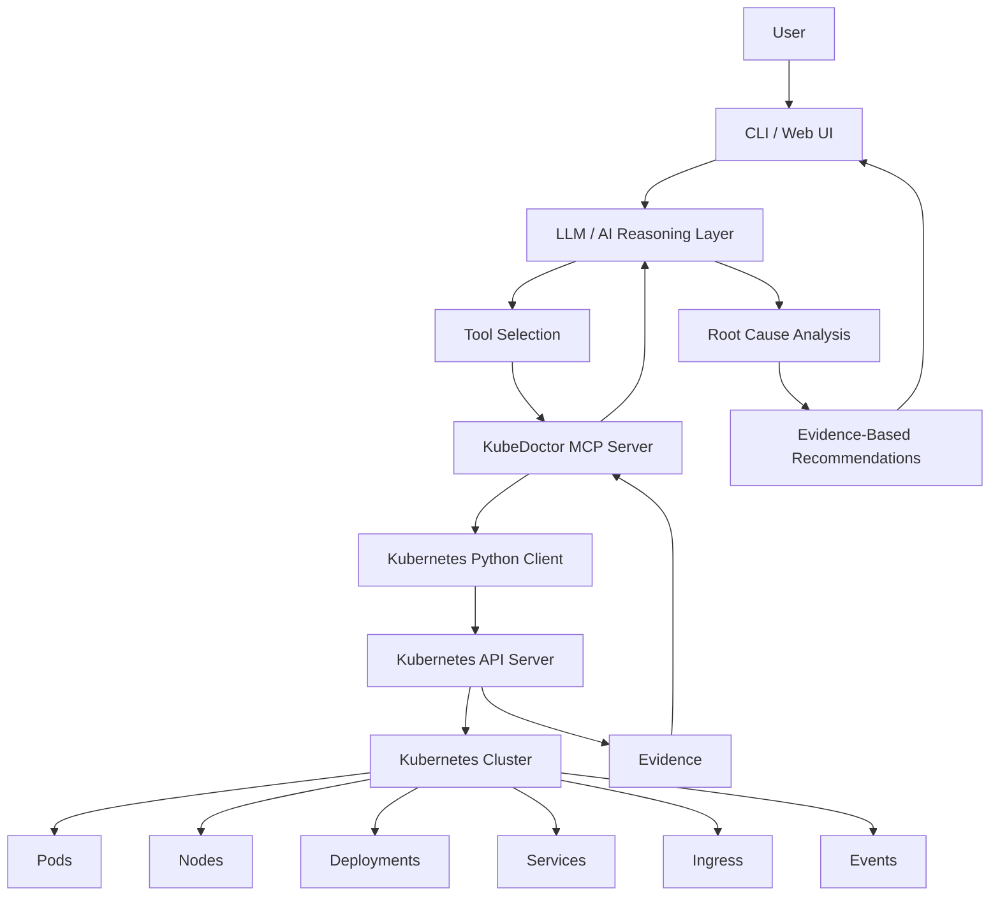

# 🩺 KubeDoctor

> **AI-powered Kubernetes troubleshooting assistant built with the Model Context Protocol (MCP).**

KubeDoctor is a Python-based Kubernetes troubleshooting project that exposes Kubernetes diagnostic capabilities through an **MCP (Model Context Protocol) server**.

It connects an MCP client to a Kubernetes cluster through the **Kubernetes Python Client**, providing a structured set of troubleshooting tools for inspecting cluster health, pods, nodes, deployments, services, ingress resources, events, and common pod failures.

The project is designed as a foundation for building an **AI-powered Kubernetes troubleshooting assistant** where an LLM can eventually select diagnostic tools, collect evidence, identify root causes, and provide evidence-based recommendations.

---

## 🎯 Project Goal

Kubernetes environments can generate a large amount of operational information:

* Pod status
* Container logs
* Kubernetes events
* Node conditions
* Deployment status
* Service configuration
* Ingress configuration
* Image-pull failures
* CrashLoopBackOff
* Pending workloads
* Namespace-level resource information

Troubleshooting often requires engineers to manually execute multiple `kubectl` commands and correlate information across different Kubernetes resources.

KubeDoctor provides a structured troubleshooting interface that allows an MCP client to invoke Kubernetes diagnostic operations through dedicated tools.

### Current workflow

```text
User
  │
  ▼
MCP Client
  │
  │ MCP / stdio
  ▼
KubeDoctor MCP Server
  │
  │ Kubernetes Python Client
  ▼
Kubernetes API Server
  │
  ▼
Kubernetes Cluster
```

The current implementation focuses on **Kubernetes diagnostics and MCP integration**.

LLM-based reasoning and autonomous troubleshooting are part of the planned roadmap.

---

# 🧠 What is MCP?

**Model Context Protocol (MCP)** is a protocol that allows AI applications and clients to interact with external tools and data sources through a standardized interface.

In KubeDoctor, MCP provides the interface between the client and Kubernetes troubleshooting capabilities.

Instead of an AI client directly implementing Kubernetes-specific logic, the client can discover and invoke tools exposed by the KubeDoctor MCP server.

For example:

```text
AI / MCP Client
       │
       │ "diagnose this pod"
       ▼
KubeDoctor MCP Server
       │
       ▼
Kubernetes Python Client
       │
       ▼
Kubernetes API
```

This separation makes the troubleshooting functionality reusable by different MCP-compatible clients.

---

# 🔌 Why MCP is Useful for KubeDoctor

Kubernetes troubleshooting requires access to live cluster information.

An AI assistant cannot reliably troubleshoot Kubernetes workloads using only its internal knowledge because cluster state changes continuously.

MCP provides a standardized mechanism for exposing live Kubernetes operations as tools.

For example, an MCP client can discover tools such as:

```text
cluster_health
list_pods
get_pod_logs
diagnose_pod
get_pod_events
node_health
diagnose_deployment
diagnose_service
diagnose_ingress
```

The client can then invoke these tools when Kubernetes information is required.

### Without MCP

```text
AI Application
   │
   ├── Kubernetes integration
   ├── Authentication logic
   ├── API calls
   ├── Tool definitions
   └── Troubleshooting logic
```

### With MCP

```text
AI / MCP Client
      │
      │ MCP
      ▼
KubeDoctor MCP Server
      │
      ▼
Kubernetes API
```

This creates a cleaner separation between:

* **AI/client layer**
* **Tool layer**
* **Kubernetes integration layer**

---

# 🚫 What MCP Does NOT Do

MCP itself is **not an AI model** and does not automatically troubleshoot Kubernetes.

MCP does not:

* ❌ Provide an LLM
* ❌ Automatically determine root cause
* ❌ Automatically fix Kubernetes resources
* ❌ Replace Kubernetes
* ❌ Replace `kubectl`
* ❌ Guarantee that a diagnosis is correct
* ❌ Automatically make destructive changes to a cluster

In the current KubeDoctor implementation, MCP is primarily used to expose Kubernetes troubleshooting operations as structured tools.

AI-driven reasoning, natural-language interaction, automatic tool selection, and remediation are planned features.

---

# 🏗️ Architecture

## Current Architecture



### Components

| Component                | Responsibility                                        |
| ------------------------ | ----------------------------------------------------- |
| User                     | Initiates troubleshooting commands                    |
| MCP Client               | Connects to the MCP server and invokes tools          |
| KubeDoctor MCP Server    | Exposes Kubernetes troubleshooting tools              |
| Kubernetes Python Client | Communicates with the Kubernetes API                  |
| Kubernetes API Server    | Provides cluster state and resource information       |
| Kubernetes Cluster       | Contains workloads and infrastructure being diagnosed |

---

# 🔄 How the Components Interact

## 1. MCP Client

The MCP client establishes a connection to the KubeDoctor MCP server using:

* `ClientSession`
* `stdio_client`
* `StdioServerParameters`

The client can initialize the MCP session and discover the available tools.

Example:

```text
Starting KubeDoctor MCP server...
Connected to KubeDoctor MCP server!
MCP initialization successful!

Available KubeDoctor tools:
- cluster_health
- list_pods
- get_pod_logs
- diagnose_pod
...
```

---

## 2. MCP Server

The KubeDoctor server is implemented using **FastMCP**.

The server exposes Kubernetes troubleshooting functionality as MCP tools.

Conceptually:

```text
MCP Server
│
├── cluster_health
├── list_pods
├── get_pod_logs
├── diagnose_pod
├── get_pod_events
├── node_health
├── diagnose_deployment
├── diagnose_service
├── diagnose_ingress
└── doctor
```

---

## 3. Kubernetes Python Client

The MCP server communicates with Kubernetes through the Kubernetes Python Client.

```text
KubeDoctor
     │
     ▼
Kubernetes Python Client
     │
     ▼
Kubernetes API Server
```

The Kubernetes client handles communication with the Kubernetes cluster rather than KubeDoctor directly implementing Kubernetes API communication.

---

# 🛠️ Current Features

KubeDoctor currently exposes the following MCP tools.

| Tool                       | Purpose                                   |
| -------------------------- | ----------------------------------------- |
| `cluster_health`           | Check overall cluster health              |
| `list_pods`                | List Kubernetes pods                      |
| `get_pod_logs`             | Retrieve pod/container logs               |
| `diagnose_pod`             | Inspect and diagnose a pod                |
| `get_pod_events`           | Retrieve events associated with a pod     |
| `detect_crashloops`        | Detect CrashLoop-related pod failures     |
| `detect_image_pull_errors` | Detect image-pull failures                |
| `detect_pending_pods`      | Detect pods stuck in Pending state        |
| `node_health`              | Inspect Kubernetes node health            |
| `diagnose_deployment`      | Diagnose deployment state                 |
| `diagnose_service`         | Inspect Kubernetes services               |
| `diagnose_ingress`         | Inspect ingress resources                 |
| `namespace_overview`       | Provide namespace-level information       |
| `doctor`                   | Run troubleshooting diagnostics for a pod |
| `pod_events`               | Retrieve pod-related Kubernetes events    |

> **Note:** These are the currently implemented KubeDoctor tools. AI/LLM-powered reasoning is not represented as a current feature.

---

# 💻 Current CLI

The current MCP client provides a simple command-driven interface.

Available commands include:

```text
health
pods
node-health
doctor <pod> <namespace>
tools
exit
```

Example:

```text
> health
```

```text
> pods
```

```text
> node-health
```

```text
> doctor my-pod default
```

```text
> tools
```

```text
> exit
```

---

# ☸️ Kubernetes Environment

KubeDoctor is currently developed and tested using:

* Windows
* Docker Desktop
* Docker Desktop Kubernetes
* Python
* Kubernetes Python Client

The current Kubernetes cluster includes nodes such as:

```text
desktop-control-plane
desktop-worker
```

Both currently report:

```text
Ready=True
```

Example cluster view:

```text
NODE                    STATUS
desktop-control-plane   Ready
desktop-worker          Ready
```

---

# 📋 Prerequisites

Before running KubeDoctor, install the following:

### Required

* Python
* `uv`
* Docker Desktop
* Kubernetes enabled in Docker Desktop
* Access to a Kubernetes cluster
* Valid Kubernetes configuration

### Verify Python

```bash
python --version
```

### Verify uv

```bash
uv --version
```

### Verify Docker

```bash
docker --version
```

### Verify Kubernetes

```bash
kubectl version --client
```

### Verify cluster access

```bash
kubectl get nodes
```

Expected example:

```text
NAME                    STATUS   ROLES           AGE
desktop-control-plane   Ready    control-plane   ...
desktop-worker          Ready    <none>          ...
```

---

# 📦 Installation

Clone the repository:

```bash
git clone https://github.com/<your-username>/KubeDoctor.git
```

Move into the project:

```bash
cd KubeDoctor
```

Install/sync the project dependencies using `uv`:

```bash
uv sync
```

The project uses `uv` for dependency and environment management.

---

# 🔧 Project Dependencies

The project is built around:

* Python
* FastMCP
* MCP Python SDK
* Kubernetes Python Client

The MCP SDK version currently used by the project is:

```text
MCP Python SDK: 1.30.0
```

Dependencies are managed through:

```text
pyproject.toml
uv.lock
```

---

# ☸️ Kubernetes Configuration

KubeDoctor requires access to a Kubernetes cluster.

For local Docker Desktop Kubernetes development, verify that Kubernetes is enabled in Docker Desktop.

Check cluster access:

```bash
kubectl get nodes
```

Check the active Kubernetes context:

```bash
kubectl config current-context
```

View available contexts:

```bash
kubectl config get-contexts
```

KubeDoctor uses the Kubernetes client configuration available to the Python Kubernetes client.

For a standard local configuration, your kubeconfig is typically available through the Kubernetes configuration used by your environment.

> **Important:** KubeDoctor should be given only the Kubernetes permissions required for the operations it needs.

---

# 🚀 Running KubeDoctor

## Start the MCP Server

From the project root:

```bash
uv run python src/kubedoctor/server.py
```

The server uses **stdio transport**.

The MCP server is intended to communicate with an MCP client through its standard input/output streams.

---

# 🤖 Running the MCP Client

Open another terminal and run:

```bash
uv run python src/kubedoctor/client.py
```

The client establishes a connection to the KubeDoctor MCP server.

A successful initialization looks similar to:

```text
Starting KubeDoctor MCP server...
Connected to KubeDoctor MCP server!
MCP initialization successful!

Available KubeDoctor tools:
- cluster_health
- list_pods
- get_pod_logs
- diagnose_pod
- get_pod_events
- detect_crashloops
- detect_image_pull_errors
- detect_pending_pods
- node_health
- diagnose_deployment
- diagnose_service
- diagnose_ingress
- namespace_overview
- doctor
- pod_events
```

---

# 🔍 Example Workflow

Suppose a Kubernetes application is not working correctly.

A typical troubleshooting workflow could be:

```text
1. Check cluster health
        ↓
2. Check node health
        ↓
3. List pods
        ↓
4. Identify unhealthy pod
        ↓
5. Run pod diagnosis
        ↓
6. Inspect events
        ↓
7. Inspect logs
        ↓
8. Identify possible failure
```

Using the current client:

```text
> health
```

Then:

```text
> node-health
```

Then:

```text
> pods
```

Then diagnose a specific pod:

```text
> doctor my-pod default
```

The troubleshooting information can then be used by an engineer to investigate the underlying Kubernetes issue.

---

# 🧪 Example Troubleshooting Scenario

## Scenario: Pod repeatedly restarting

Consider a workload where a pod is experiencing repeated container restarts.

A traditional Kubernetes troubleshooting workflow might involve:

```bash
kubectl get pods
kubectl describe pod <pod>
kubectl logs <pod>
kubectl get events
```

With KubeDoctor, the equivalent diagnostic capabilities can be accessed through MCP tools.

Example:

```text
> pods
```

Identify the problematic pod:

```text
my-application-7f8c9d6b5f-x2abc
```

Run:

```text
> doctor my-application-7f8c9d6b5f-x2abc default
```

KubeDoctor can use its Kubernetes diagnostic tools to inspect relevant information such as:

* Pod state
* Container state
* Restart information
* Kubernetes events
* Logs
* Failure conditions

The current project provides the diagnostic information; **automatic AI root-cause reasoning is planned for a future phase**.

---

# 🧩 MCP Tool Discovery

One of the important capabilities of the current client is MCP tool discovery.

After connecting to the server, the client can retrieve the available tools.

Conceptually:



This demonstrates the separation between the client and the Kubernetes troubleshooting implementation.

---

# 📁 Project Structure

Current project structure:

```text
KubeDoctor/
├── pyproject.toml
├── uv.lock
├── README.md
└── src/
    └── kubedoctor/
        ├── __init__.py
        ├── server.py
        └── client.py
```

### `pyproject.toml`

Project metadata and Python dependency configuration.

### `uv.lock`

Locked dependency versions generated and maintained by `uv`.

### `server.py`

Contains the KubeDoctor MCP server implementation and Kubernetes troubleshooting tools.

### `client.py`

Contains the MCP client implementation.

It uses:

```text
ClientSession
stdio_client
StdioServerParameters
```

to connect to the MCP server and interact with its tools.

### `__init__.py`

Python package initialization.

---

# 🧱 Technology Stack

| Technology               | Role                                     |
| ------------------------ | ---------------------------------------- |
| Python                   | Application language                     |
| uv                       | Python package/project management        |
| MCP Python SDK           | MCP implementation                       |
| FastMCP                  | MCP server framework                     |
| Kubernetes Python Client | Kubernetes API integration               |
| Kubernetes               | Target orchestration platform            |
| Docker Desktop           | Local Kubernetes development environment |
| stdio                    | MCP transport                            |
| Mermaid                  | Architecture/documentation diagrams      |

---

# 🔐 Security Considerations

KubeDoctor interacts with a Kubernetes API and therefore should be treated as a privileged operational component.

### Current security considerations

* Use a dedicated Kubernetes identity where possible.
* Follow the principle of least privilege.
* Avoid using highly privileged cluster-admin credentials unnecessarily.
* Protect kubeconfig files.
* Do not commit credentials or secrets to Git.
* Avoid storing sensitive Kubernetes logs in source control.
* Review Kubernetes RBAC permissions before connecting KubeDoctor to shared clusters.

### Future security considerations

As AI capabilities are introduced, additional controls will be important:

```text
AI Client
   │
   ▼
Permission Boundary
   │
   ▼
MCP Server
   │
   ▼
RBAC
   │
   ▼
Kubernetes API
```

Potential future controls include:

* Read-only diagnostic roles
* Explicit approval for write operations
* Tool-level authorization
* Audit logging
* Namespace restrictions
* Sensitive-data filtering
* Secret redaction
* Production-cluster safeguards

---

# ⚠️ Current Limitations

KubeDoctor is currently a **development/portfolio project**.

Current limitations include:

* No production-grade deployment model yet.
* No web UI.
* No natural-language troubleshooting interface yet.
* No integrated LLM reasoning layer yet.
* No autonomous root-cause analysis yet.
* No automatic remediation.
* No automatic tool-selection logic driven by an LLM.
* Current development environment is primarily Docker Desktop Kubernetes on Windows.
* MCP communication currently uses stdio.
* Production-scale security and authorization controls are not yet implemented.

These limitations are intentional areas for future development.

---

# 🤖 Planned AI Architecture

The long-term goal is to evolve KubeDoctor from a Kubernetes diagnostic tool into an **AI-powered Kubernetes troubleshooting assistant**.

## Future Architecture



---

# 🧠 Planned AI Workflow

The future troubleshooting flow could look like:

```text
User:
"Why is my application failing?"

        ↓

AI Reasoning Layer

        ↓

Select diagnostic tools

        ↓

KubeDoctor MCP Server

        ↓

Kubernetes API

        ↓

Collect evidence

        ↓

Analyze evidence

        ↓

Identify probable root cause

        ↓

Generate evidence-based recommendations

        ↓

Present findings to user
```

The AI layer should not blindly execute commands.

Instead, it should collect relevant evidence through MCP tools and explain how that evidence supports the diagnosis.

---

# 🗺️ Roadmap

## Phase 1 — Kubernetes MCP Foundation ✅

* [x] Python project setup
* [x] `uv` dependency management
* [x] MCP server
* [x] FastMCP integration
* [x] Kubernetes Python Client integration
* [x] stdio MCP transport
* [x] MCP client
* [x] MCP session initialization
* [x] MCP tool discovery
* [x] Kubernetes health/troubleshooting tools

---

## Phase 2 — Interactive CLI 🚧

* [ ] Interactive troubleshooting CLI
* [ ] Improved command handling
* [ ] Better diagnostic output
* [ ] Structured troubleshooting reports
* [ ] Improved error handling

---

## Phase 3 — AI/LLM Integration 📋

* [ ] LLM integration
* [ ] Natural-language Kubernetes troubleshooting
* [ ] Automatic MCP tool selection
* [ ] Multi-step troubleshooting workflows
* [ ] Root-cause analysis
* [ ] Evidence-based recommendations

---

## Phase 4 — User Experience 📋

* [ ] Web UI
* [ ] Troubleshooting dashboard
* [ ] Real-time cluster diagnostics
* [ ] Historical troubleshooting information
* [ ] Human approval workflow

---

## Phase 5 — Production Kubernetes Support 📋

* [ ] Production-grade deployment
* [ ] Kubernetes-native deployment
* [ ] RBAC integration
* [ ] Authentication and authorization
* [ ] Audit logging
* [ ] Multi-cluster support
* [ ] Namespace-level access controls
* [ ] Secure production operating model

---

# 📊 Current vs Planned Capabilities

| Capability                       | Current | Planned |
| -------------------------------- | :-----: | :-----: |
| Kubernetes API integration       |    ✅    |         |
| MCP server                       |    ✅    |         |
| MCP client                       |    ✅    |         |
| MCP tool discovery               |    ✅    |         |
| Kubernetes diagnostics           |    ✅    |         |
| Pod troubleshooting              |    ✅    |         |
| Node health checks               |    ✅    |         |
| Deployment diagnostics           |    ✅    |         |
| Service diagnostics              |    ✅    |         |
| Ingress diagnostics              |    ✅    |         |
| CrashLoop detection              |    ✅    |         |
| Image-pull error detection       |    ✅    |         |
| Pending pod detection            |    ✅    |         |
| LLM integration                  |         |    📋   |
| Natural-language troubleshooting |         |    📋   |
| Automatic tool selection         |         |    📋   |
| Root-cause analysis              |         |    📋   |
| Evidence-based recommendations   |         |    📋   |
| Web UI                           |         |    📋   |
| Automatic remediation            |         |    📋   |
| Production Kubernetes support    |         |    📋   |

---

# 🧪 Development Philosophy

KubeDoctor is being developed around a few principles:

### 1. Evidence first

Troubleshooting should be based on actual Kubernetes state rather than assumptions.

### 2. Tool-driven diagnostics

Kubernetes operations should be exposed through clearly defined tools.

### 3. AI as a reasoning layer

The planned AI component should interpret evidence rather than replace Kubernetes diagnostics.

### 4. Human-in-the-loop

Especially for production environments, recommendations should be reviewable before any potentially impactful action.

### 5. Cloud-native design

The project is designed around Kubernetes-native concepts and modern cloud-native tooling.

---

# 🤝 Contributing

Contributions, ideas, and feedback are welcome.

To contribute:

```bash
git clone https://github.com/<your-username>/KubeDoctor.git
cd KubeDoctor
uv sync
```

Create a feature branch:

```bash
git checkout -b feature/my-feature
```

Make your changes and test them against a Kubernetes development environment.

Commit your changes:

```bash
git add .
git commit -m "feat: add my feature"
```

Push the branch:

```bash
git push origin feature/my-feature
```

Then open a Pull Request.

### Contribution Ideas

Areas that could benefit from contributions include:

* New Kubernetes diagnostic tools
* Better error handling
* CLI improvements
* Test coverage
* MCP improvements
* Documentation
* AI/LLM integrations
* Kubernetes security
* Observability integrations

---

# 📜 License

License information will be added to this repository.

```text
License: TBD
```

---

# 👨‍💻 Author

**Rahul Dan**

DevOps / Cloud Platform Engineer specializing in:

* Kubernetes
* Cloud Native technologies
* AWS
* Docker
* CI/CD
* Linux
* Kubernetes troubleshooting
* Cloud infrastructure

KubeDoctor is a personal Cloud Native engineering project focused on exploring the intersection of **Kubernetes operations, MCP, and AI-powered troubleshooting**.

---

# ⭐ Project Vision

KubeDoctor aims to evolve from a collection of Kubernetes diagnostic tools into an intelligent troubleshooting platform:

```text
                KubeDoctor
                    │
        ┌───────────┴───────────┐
        │                       │
 Kubernetes Diagnostics      AI Reasoning
        │                       │
        └───────────┬───────────┘
                    │
             Evidence-Based
              Troubleshooting
                    │
                    ▼
          Faster Kubernetes
             Operations
```

The long-term vision is to provide engineers with a conversational interface for Kubernetes troubleshooting while keeping the underlying diagnostics **transparent, tool-driven, evidence-based, and controllable**.

---

## 🚀 Status

**Current Status:** 🟢 Active Development

**Focus:** MCP-based Kubernetes troubleshooting foundation

**Next Major Milestone:** Interactive CLI → LLM integration → Natural-language Kubernetes troubleshooting

---

> **KubeDoctor — Bringing structured Kubernetes diagnostics to the MCP ecosystem.**
